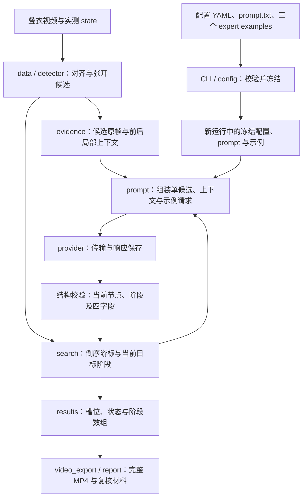

# 运行架构与配置边界

协议：`reverse_node_v2`。日期：2026-10-26。状态：配置加载、示例冻结、单候选请求、搜索恢复和汇总已接入，离线检查 197 passed。v2 使用 [configs/reverse_node_v2.yaml](configs/reverse_node_v2.yaml)；`configs/default.yaml` 及包内 `node_shape_prompt_v3.txt` 保留 v1。真实实验与视频验证另见 [README.md](README.md) 和对应运行报告，不从离线检查推断模型质量。

业务语义以 [boundary.md](boundary.md) 为准，实施顺序见 [DEVELOPMENT.md](DEVELOPMENT.md)，请求字段见 [docs/PROMPT.md](docs/PROMPT.md)。本文负责说明配置入口、模块职责和运行数据流，不另定义阶段判据。

## 1. 配置入口

沿用本库现有的 `configs/` 目录。v2 固定的 system prompt 独立放在 [configs/prompt.txt](configs/prompt.txt)，作为可版本化的配置输入；[v2 YAML](configs/reverse_node_v2.yaml) 显式配置：

```yaml
prompt_file: prompt.txt
prompt_version: node_completion_prompt_v1
```

`prompt_file` 以及 expert example 路径均相对所选 YAML 文件所在目录解析，不依赖启动命令时的工作目录。`prompt_version` 用于标识版本，实际内容的 SHA-256 是运行核验依据；只改版本名不能掩盖内容变化。完整配置见 [configs/reverse_node_v2.yaml](configs/reverse_node_v2.yaml)，`configs/default.yaml` 继续保留 v1。

`configs/prompt.txt` 是 v2 固定模型指令的唯一编辑入口。`prompt.py` 只负责读取冻结文本和组装当前目标、节点 ID、图像角色、时间标签，不内嵌另一份阶段判定文本。`docs/PROMPT.md` 解释接口并链接配置文件，不复制全文。用户以后调整固定 prompt 时修改配置文本，无需改 Python 代码。

prepare 校验 prompt 文件存在、可按 UTF-8 读取且非空，以及三个阶段的示例齐全、可解码，图片预算涵盖局部上下文及一张示例。错误在真实请求前报告，v2 不静默回退到旧包内 prompt。旧资产与历史运行保留。

## 2. 模块职责与数据流



| 模块 | 负责内容 | 职责边界 |
| --- | --- | --- |
| `cli.py` / `config.py` | 加载配置、prompt 路径和示例映射，校验并冻结运行输入，调度 prepare/annotate/report/export。 | 不在运行中隐式切换配置或补造候选。 |
| `expert_examples.py` | 检查源示例、按原字节冻结三张图及映射，核验冻结索引和图像摘要，提供当前阶段的一张示例。 | annotate 和恢复不读取可变源图；任意阶段的冻结图或索引被改动都拒绝继续。 |
| `data.py` / `detector.py` | 校验时间轴，从实测 state 独立检测任意一爪张开事件。 | 不依赖 VLM 或人工边界，不因模型回答移动候选。 |
| `evidence.py` | 复用候选精确原帧与固定时间上下文取样，保存原帧、时间、角色与摘要。 | 上下文按时间正序排列；候选原帧不能用附近帧替代。 |
| `prompt.py` | 合并冻结 prompt、当前目标、单候选及局部上下文和对应阶段的一张示例，生成可追溯请求。 | 只指定一个当前节点；不决定搜索方向或更改模型结论。 |
| `provider.py` | 区分示例与本轨迹图像标签，发送请求，保存原始响应、传输重试和用量。 | 默认至多五张本轨迹图像加一张示例；示例没有本轨迹时间戳，不选择阶段或把语义不匹配当成重试。 |
| `search.py` | 维护倒序游标、stage3→2→1、响应身份校验与恢复重放。 | 只有当前节点的合法 `match` 可填槽；上下文不接受批量判定。 |
| `results.py` | 校验槽位来源、顺序和区间，输出状态、逐阶段 `search_status`、缺槽原因及标签。 | 区分未搜索、未找到和执行失败，不把 `complete` 当作人工确认。 |
| `video_export.py` / report | 读取已保存结果，生成完整视频、复核报告及 `reports/request_images.json` 请求图像索引。 | 不调用 provider，不回写历史运行或人工真值。 |

底层数据与检测不依赖 prompt/provider；provider 不决定阶段；可视化读取已有结果。真实 API 只在 annotate 阶段按任务授权调用，离线 prepare 和模拟测试不联网。

## 3. 冻结、指纹与恢复

prepare 将配置及输入摘要写入 `runs/<run_id>/run.json`，把所选 `configs/prompt.txt` 的原文（含原换行）冻结为运行内的 `prompt.txt`，把三个示例及阶段映射冻结到 `expert_examples/`。当前示例不转换，源图与发送图字节相同；`index.json` 记录源路径、源文件及发送图摘要、尺寸、MIME 类型和 `image_processing.mode=original_bytes`。

annotate 从运行内的冻结文本和示例构造请求，源配置文件在 prepare 后被修改不会悄悄改变该运行。采用修改后的 prompt 或示例时新建运行；冻结副本被改动则拒绝恢复。每个请求的指纹覆盖完整固定文本、动态文本、模型参数、协议、当前节点与目标、候选及局部上下文的原帧/角色/顺序/时间/图像摘要、上下文取样配置、示例阶段映射与摘要。

请求、原始响应和合法判断先持久化，再推进搜索状态。恢复时验证冻结输入及请求指纹，按原顺序重放已有判断。合法 `skip`/`uncertain` 不通过更换示例、扩图或重复调用换答案。

## 4. 实现证据与实验边界

v2 已完成配置读取、冻结、带示例的单候选请求、搜索和恢复接入；`.venv/bin/python -m pytest -q` 实际结果为 197 passed，模拟调用不联网。`runs/p1_reverse_node_v2_examples_20261026/` 已用同一十条清单完成离线 prepare，共 6568 帧、148 个候选，真实调用按本轮授权从 000543 开始。十条真实结果、完整 MP4 和视觉评估以该运行报告及 README 的实际记录为准。离线测试通过与模型效果、视频交付、人工确认分别报告。
